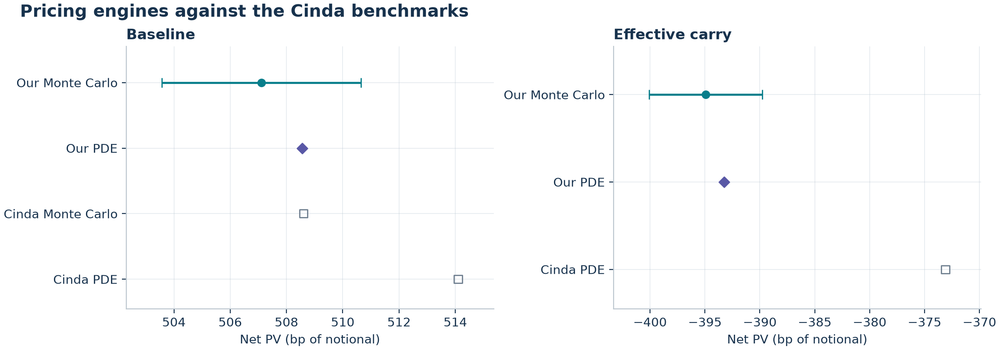

# Snowball Autocallable Pricing and Risk

This research project prices a discrete-barrier Snowball with two independent Black–Scholes engines and tests how its hedge changes with spot, observation dates and knock-in history. The project grew out of an interest in structured derivatives developed during a quantitative finance internship. The contract and reference values come from Cinda Securities. The implementation, numerical experiments, tests and figures were developed independently. [Cinda Securities research report, July 21, 2021](https://bigdata-s3.wmcloud.com/researchreport/2021-07/b025f87ecb207bafca79ade86110b98d.pdf)



## Benchmark results

Values are time-zero present values per unit notional of the investor's **net settlement cash flow**. The Monte Carlo estimates use 300,000 independent paths per case. Both PDE values fall inside the corresponding Monte Carlo 95% interval.

| Scenario | Monte Carlo | Monte Carlo 95% interval | Two-state PDE | Cinda MC | Cinda PDE |
| --- | ---: | ---: | ---: | ---: | ---: |
| Baseline | 0.050711 | [0.050357, 0.051065] | 0.050856 | 0.05086 | 0.05141 |
| 18.82% coupon, 19% volatility, 11% effective yield | −0.039493 | [−0.040008, −0.038978] | −0.039325 | — | −0.03731 |

The baseline Monte Carlo result is 1.49 bp below the published Monte Carlo value. The baseline and effective-carry PDE values are 5.54 bp and 20.15 bp below their published references. The technical report analyzes the calendar sensitivity, the limits of the effective-carry assumption and an inconsistency in the published timing statistics. [Technical report](TECHNICAL_REPORT.md) · [Benchmark table](results/benchmarks.csv) · [Cross-method errors](results/cross_method.csv)

## Contract and settlement

The baseline has reference spot $S_0=1$, unit notional, one-year maturity, a 20% annual coupon, 3% risk-free rate, 13% volatility and zero dividend yield. Spot is observed for knock-in (KI) at each of 252 synthetic trading closes. Knock-out (KO) is observed every 21 closes, including maturity. KO requires $S\ge 1.03S_0$ and KI requires $S<0.85S_0$. The issue spot sets the contract levels. A later KO settles the same coupon whether or not KI has occurred.

| Case | Net cash flow per unit notional | Payment |
| --- | ---: | --- |
| KO without prior KI | Coupon × accrued year fraction | First KO |
| Neither barrier event | Coupon × full year fraction | Maturity |
| KI without KO, terminal spot at or above reference | 0 | Maturity |
| KI without KO, terminal spot below reference | $S_T/S_0-1$ | Maturity |
| KI followed by KO | Coupon × accrued year fraction | First KO |

Model time and coupon accrual both use trading step / 252 in the baseline. The schedule can use supplied dates on ACT/365F or separate model times and accrual fractions. Each payment settles at the observation close. Gross redemption adds principal to that same cash flow. The baseline PDE gross PV is **1.036652**. For an investor who pays par at issue, the gross PV less par is **0.036652**, with principal discounted through the actual redemption date. [Payoff scenarios](figures/01_payoff_scenarios.png) · [Contract API](src/snowball/contract.py)

## Pricing and risk methods

- **Monte Carlo.** Exact GBM steps under $dS=(r-q)S\,dt+\sigma S\,dW^{\mathbb Q}$. NumPy batches limit path memory. Cash flows are classified independently of simulation and discounted to their own settlement times. Optional antithetics use pair means for the standard error.
- **Finite differences.** Crank–Nicolson on a log-spot grid with one continuation value for each KI state. Monthly KO resets both states to the accrued payout. Daily KI transfers the clean state to the knocked-in state. A tridiagonal solver, cell averaging at event jumps and Rannacher damping control numerical oscillations.
- **Decomposition.** The net claim equals an accrued-coupon call leg plus a double-survival coupon, short an up-and-out put and long a double-out put. The report derives this pathwise and checks each leg against independent Monte Carlo samples. [Leg comparisons](results/decomposition.csv)
- **Greeks.** Spot, volatility and rate bumps hold the reference and event dates fixed. Calendar Theta is measured between events. Common shocks pair the Monte Carlo bump-and-revalue samples. At the baseline reference spot, the PDE gives Delta of **−0.29** in the clean state and **+0.24** conditional on prior KI. The short first-call accrual competes with the downside exposure. [Delta curves](figures/08_delta_vs_spot.png) · [Gamma bump study](figures/09_gamma_vs_spot.png) · [Greeks by parameter](results/parameter_risk.csv)
- **Dynamic hedging.** The issuer receives the net claim's fair premium, funds inventory through the cash account, and closes the hedge at settlement. On 10,000 common paths, the unhedged, daily and weekly frictionless P&L standard deviations are about 1,025, 172 and 325 bp at a common maturity. Daily hedging trades more and incurs larger costs at the same fee rate. [Hedge paths](figures/11_hedge_positions.png) · [Hedge P&L](figures/12_hedging_pnl.png) · [Hedge statistics](results/hedge_summary.csv)

## Reproduce the experiments

From a clean checkout with CPython 3.12, run the following commands. The constraints file pins the main libraries used for the archived outputs.

```bash
python3.12 -m venv .venv
source .venv/bin/activate
python -m pip install -c requirements-repro.txt '.[test,notebook]'
python -m pytest
python scripts/run_research.py
jupyter execute notebooks/research_walkthrough.ipynb
```

The full script writes CSV tables to `results/` and 200 dpi PNGs to `figures/`. Use `--quick --output /tmp/snowball-quick` for a smaller run in a separate directory. The settings, seeds, dependency versions and elapsed runtime are recorded in [results/metadata.json](results/metadata.json). [Notebook](notebooks/research_walkthrough.ipynb)

```python
from snowball import Market, Snowball, price_monte_carlo, solve_pde

terms, market = Snowball(), Market()
mc = price_monte_carlo(terms, market, n_paths=300_000, seed=42)
pde = solve_pde(terms, market)
print(mc.price, mc.estimate.confidence_interval, pde.price)
```

| Location | Contents |
| --- | --- |
| [src/snowball](src/snowball/) | Contract, payoff, exact simulation, pricers, Greeks, hedge and diagnostics |
| [tests](tests/) | Payoff chronology and equality, analytic limits, seed and CI checks, convergence and hedge cash accounting |
| [scripts](scripts/) and [notebooks](notebooks/) | Reproducible experiments and a shorter walkthrough |
| [results](results/) and [figures](figures/) | Generated tables, representative paths and risk charts |

## Scope

The experiments use synthetic paths with constant volatility, rates and carry. They omit jumps, a volatility surface, counterparty credit, liquidity limits, operational lags and model calibration to market data. The effective dividend yield is a proxy for the report's basis and funding scenario. A futures hedge also introduces margin cash flows, rolls and basis risk. The hedge results measure replication under the assumed model and a linear trading fee. [Model and experimental details](TECHNICAL_REPORT.md)

Development used an AI coding assistant; model design choices, numerical results and conclusions were reviewed and verified by the author.
